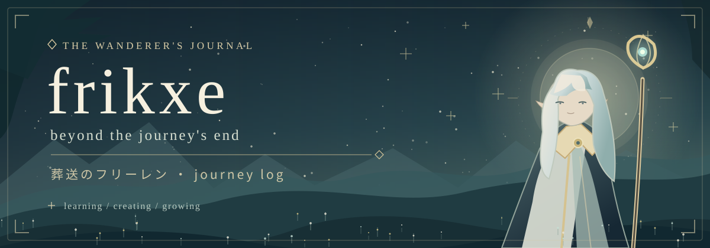
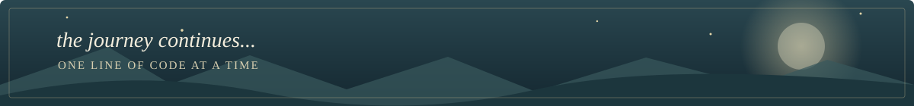

  

   

  *「 The journey is far from over. 」*

  an aspiring web developer · learning a little more every day

 

### ✧ About this traveler

Hey, I'm **frikxe**. I like quiet aesthetics, beautiful interfaces, and learning how things work.

I'm currently learning **JavaScript** and practicing **frontend development**.

Not in a hurry. Just collecting experience along the way. ☘

 

### ✧ Spells I'm learning

  

JavaScript · HTML · CSS · Git · GitHub · VS Code

 

### ✧ Adventurer's journal

`01`  Learn something new  ·  `02`  Build something small  ·  `03`  Keep going

 

<a href="https://github.com/frikxe?tab=repositories">✦ explore my repositories ✦</a>

  

“Even the smallest steps become part of a long journey.”

 

  inspired by 葬送のフリーレン · Frieren: Beyond Journey's End

