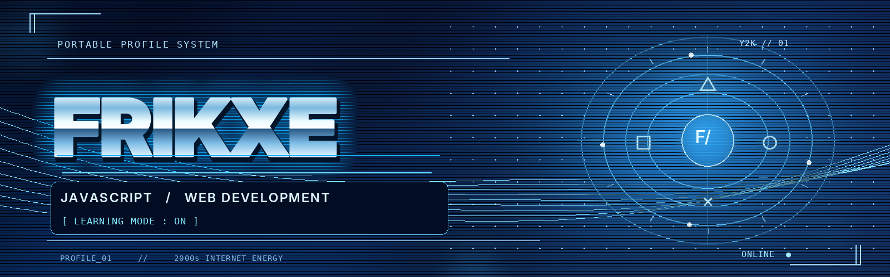

<div align="center">




<br />

**`PRESS START TO CODE  ✦  LEARN / BUILD / REPEAT`**

</div>

### `01 // PLAYER PROFILE`

```text
╭──────────────────────────────────────────╮
│  USERNAME       frikxe                   │
│  CLASS          Aspiring Developer       │
│  MAIN QUEST     Learn JavaScript         │
│  SIDE QUEST     Explore Web Development  │
│  STATUS         Work in progress...      │
╰──────────────────────────────────────────╯
```

Hey, I'm **frikxe**. I'm learning JavaScript and exploring web development, one project at a time. I like trying new ideas, experimenting with code, and figuring out how things work.

### `02 // EQUIPPED SKILLS`

<p>
  
  
</p>

### `03 // MEMORY STICK`

**◈ JavaScript Calculator**  
A small practice project for learning the basics of JavaScript.

*More save slots coming soon...*

### `04 // NEXT LEVEL`

- [x] Write my first JavaScript programs
- [ ] Build more small web projects
- [ ] Keep improving my coding skills

<div align="center">


</div>
