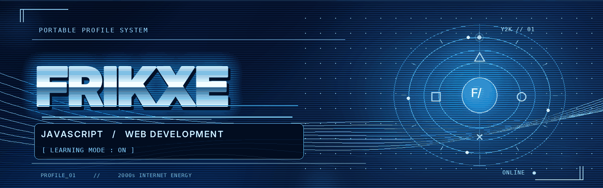
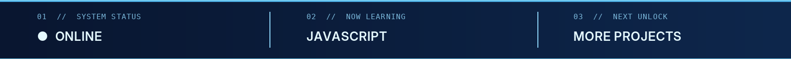
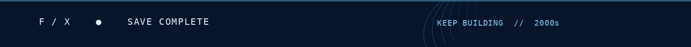

<div align="center">




<br />

**`◯ PRESS START TO CODE`** &nbsp; `△ LEARN` &nbsp; `□ BUILD` &nbsp; `× REPEAT`

</div>

---

### `01 // PLAYER PROFILE`

```text
╭──────────────────────────────────────────────╮
│  USERNAME        frikxe                      │
│  CLASS           Aspiring Software Developer │
│  CURRENT QUEST   Learn JavaScript            │
│  SIDE QUEST      Explore Web Development     │
│  STATUS          Work in progress...         │
╰──────────────────────────────────────────────╯
```

Hey, I'm **frikxe**. I'm learning **JavaScript** and exploring **web development**, one project at a time. I enjoy experimenting with code, figuring out how things work, and turning small ideas into real projects.

### `02 // XMB • SYSTEM MENU`

<div align="center">

| ◯ PROFILE | △ SKILLS | □ ACTIVITY | × OBJECTIVES |
|:---:|:---:|:---:|:---:|
| [About](#01--player-profile) | [Learning](#03--equipped-skills) | [GitHub stats](#05--activity-monitor) | [Goals](#06--next-level) |

`PORTABLE PROFILE SYSTEM` &nbsp; `//` &nbsp; `NETWORK: ONLINE`

</div>

### `03 // EQUIPPED SKILLS`

<p align="center">
  
  
</p>

### `04 // PROJECTS`

**JavaScript Calculator**  
A small practice project built while learning JavaScript fundamentals.

*More projects in progress...*

### `05 // ACTIVITY MONITOR`

<div align="center">


<sub>Live GitHub cards reflect public repositories and activity, not skill level.</sub>

</div>

### `06 // NEXT LEVEL`

- [x] Write my first JavaScript programs
- [ ] Build more small web projects
- [ ] Practice JavaScript regularly
- [ ] Keep learning and improving

---

<div align="center">



`SYSTEM READY` &nbsp; `//` &nbsp; `FRIKXE • Y2K EDITION`

</div>
